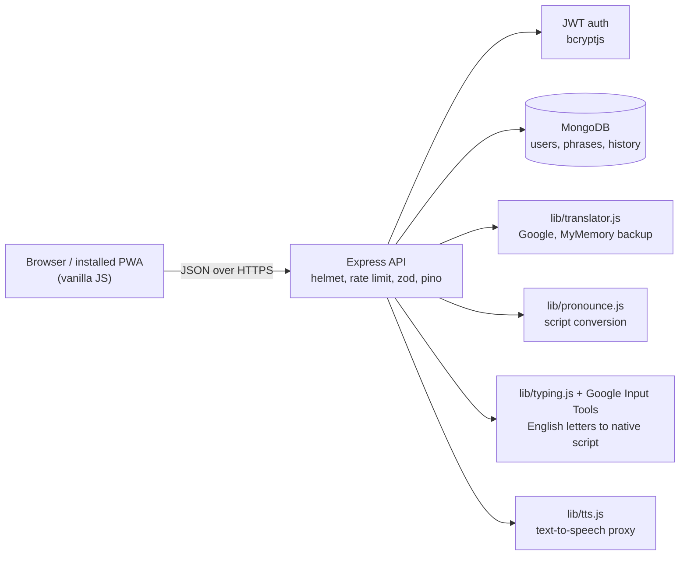

# Anuvaad (అనువాదం · अनुवाद · ಅನುವಾದ)

> *Anuvaad* means "translation" in Hindi. The app helps text and speech move across languages.

[](https://github.com/YOUR_USERNAME/anuvaad/actions)

**Live demo:** https://YOUR-APP.onrender.com (free tier: the first load after idle can take about a minute)

Type or speak one sentence in **English, Telugu, Hindi or Kannada** and get it in the other three, with **how to pronounce it written in Telugu script**. You can type Telugu, Hindi or Kannada using English letters (`nenu bagunnanu` becomes నేను బాగున్నాను). Log in to keep a phrasebook and history that follow you between phone and laptop. Installs on a phone as a PWA.

<!-- Add a phone screenshot or demo GIF here:  -->

## Features

- One sentence in, three translations out, in parallel
- Pronunciation in Telugu script and Roman letters (Devanagari and Kannada are converted by an offline algorithm)
- Type in English letters with a live native-script preview, or speak (browser speech recognition)
- Consistent audio on every device, with a normal and a slow speed
- Accounts (JWT), saved phrases and history stored in MongoDB
- Installable PWA, works on mobile and desktop

## Architecture



## API

| Method | Path | Auth | Purpose |
|---|---|---|---|
| POST | `/api/auth/signup` | | Create an account, returns a JWT |
| POST | `/api/auth/login` | | Log in, returns a JWT |
| GET | `/api/auth/me` | yes | Current user |
| POST | `/api/translate` | optional | `{text, source}` returns the other three languages. Logged-in users also get history. |
| GET | `/api/transliterate?lang=te&text=nenu` | | English letters to native script |
| GET | `/api/speak?lang=hi&text=...&slow=1` | | MP3 audio |
| GET / POST | `/api/phrases` | yes | List or save phrases |
| DELETE | `/api/phrases/:id` | yes | Delete one of your phrases |
| GET / DELETE | `/api/history` | yes | Recent sentences (30 days) / clear |
| GET | `/api/health` | | Health check |

## Data model (MongoDB)

| Collection | Fields | Indexes |
|---|---|---|
| `users` | email, name, passwordHash | unique `email` |
| `phrases` | user, source, text, lang, translation, telugu, roman | unique `(user, lang, translation)` so saving twice is a no-op; `(user, createdAt desc)` for the list |
| `histories` | user, source, text, count, lastUsedAt | unique `(user, source, text)`; **TTL** on `lastUsedAt` (30 days) |

## Design decisions

- **Swappable translation layer.** Free Google endpoints are unofficial, so `lib/translator.js` is the only file that knows about them and has a MyMemory fallback. Replacing it with a self-hosted IndicTrans2 service changes one file.
- **Telugu-script pronunciation without libraries.** Devanagari, Telugu and Kannada follow the same Unicode layout, so converting between them is a code-point shift plus a few special cases. Hindi drops word-final "a", which is handled explicitly.
- **Two-tier typing support.** Google Input Tools handles natural spelling. If it is down, a rule-based engine (`lib/typing.js`) takes over, so typing never breaks.
- **Dependency injection for testability.** `createApp()` takes the translator, speech and input-tools functions as arguments, so API tests run with no network.
- **JWT in `Authorization` header.** Simple and stateless. The trade-off is that the token lives in `localStorage`, which is exposed to XSS. Helmet's strict CSP (no inline scripts) reduces that risk; httpOnly cookies plus CSRF protection would be the next step.
- **Auth hardening.** bcrypt (pure-JS `bcryptjs`, so no native build on free hosts), identical error for unknown email and wrong password, a dummy hash comparison so both take the same time, and tighter rate limits on auth routes.
- **Graceful degradation.** One failing language does not fail the request, audio falls back to the device voice, and the in-memory cache keeps repeated sentences instant.

## Run locally

Needs Node 20+ and MongoDB (local, or a free Atlas M0 cluster).

```bash
npm install
cp .env.example .env     # set MONGODB_URI and JWT_SECRET
npm run dev              # http://localhost:3000
```

## Tests

```bash
npm test
```

Unit tests cover pronunciation and typing conversion. API tests (supertest) cover validation, translation with partial failure, signup and login, per-user phrase isolation, history, transliteration fallback and audio. They use a throwaway in-memory MongoDB, or `TEST_MONGODB_URI` if set (CI uses a MongoDB service container). GitHub Actions runs everything on each push.

## Deploy for free (MongoDB Atlas + Render)

1. Create a free **Atlas M0** cluster, a database user, and allow access from `0.0.0.0/0`. Copy the connection string.
2. Push this repo to GitHub.
3. On Render choose **New > Blueprint** and select the repo. `render.yaml` creates the service and generates `JWT_SECRET`. Paste your connection string as `MONGODB_URI` when asked.
4. Open the `onrender.com` link on your phone and use **Add to Home screen**.

## Known limits

- Machine translation: double-check important phrases with a native speaker.
- Translation, audio and typing helpers use free unofficial Google endpoints and may be rate limited.
- Hindi pronunciation does not drop silent "a" inside words (kamal is shown as kamala).
- Free hosting sleeps when idle.

## Roadmap

Spaced-repetition flashcards from saved phrases, a self-hosted IndicTrans2 translator, httpOnly-cookie auth, Docker.
